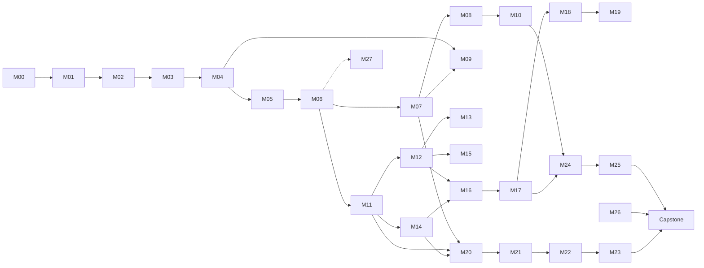

# 02 · Curriculum map

## 1. Structure and IDs

```text
Phase (p0…p6) → Module (m00…m27) → Lesson (mNN-lNN) → components
                                  → Module checkpoint (mNN-checkpoint)
               → Phase exam (pN-exam) + Portfolio project (pN-project)
Capstone (capstone) · Electives (e1…e7)
```

* Lesson files: `site/modules/<module-folder>/lNN-<slug>.html`. The folder and slugs are listed in the phase files.
* **Everything runs on the learner's computer.** Pages show code and its verified output; learners copy or download it and run it. Exercises are pytest packs (`spec/05`). Quizzes are the only thing that is answered in the page.
* **Work-mode legend:** **L** = scripts and pytest packs (every module). **N** = Jupyter notebooks as well (exploration, plots, training runs). **W** = workflow tasks outside Python (terminal, Git, CI, Docker, servers, cloud), checked by checklists and project rubrics.
* Each phase file gives, for every lesson: the **Essential** content, the **Extra & advanced** content that makes the lesson a complete reference, its **reference targets** (`Ref:`), and the graded exercises as `signature → behaviour`. Claude writes starters, tests and quizzes from those, following `spec/05` and `spec/06`.
* **New lessons are appended** to their module (IDs are permanent): the reference lessons M01-L07, M05-L06, M06-L07, M07-L08, M08-L08, M11-L08, M12-L10, M13-L07, M18-L09, M21-L08, and the reference module M27.

## 2. Master table

| ID | Module | Folder | Phase | Lessons | Hours | Mode | Needs |
|---|---|---|---|---|---|---|---|
| M00 | Start Here: Learn, Set Up, Use This Course | `m00-start-here` | P0 | 5 | 6 | L W | none |
| M01 | First Steps in Python | `m01-first-steps` | P1 | 7 | 7.5 | L | M00 |
| M02 | Control Flow | `m02-control-flow` | P1 | 6 | 7 | L | M01 |
| M03 | Core Data Structures | `m03-data-structures` | P1 | 7 | 9 | L | M02 |
| M04 | Functions | `m04-functions` | P1 | 7 | 9 | L | M03 |
| M05 | Strings, Text & Binary Data | `m05-strings-text` | P1 | 6 | 8.5 | L | M04 |
| M06 | Files, Errors & Modules | `m06-files-errors-modules` | P1 | 7 | 9.5 | L W | M05 |
| M07 | Object-Oriented Programming | `m07-oop` | P2 | 8 | 12 | L | M06 |
| M08 | Pythonic & Advanced Python | `m08-advanced-python` | P2 | 8 | 12.5 | L | M07 |
| M09 | Data Structures & Algorithms for Interviews | `m09-dsa` | P2 | 10 | 18 | L | M04 (M07 for trees) |
| M10 | Software Engineering Practices | `m10-software-engineering` | P2 | 8 | 12 | L W | M08 |
| M11 | NumPy | `m11-numpy` | P3 | 8 | 11 | L | M06 |
| M12 | pandas | `m12-pandas` | P3 | 10 | 17 | L N | M11 |
| M13 | Data Visualization & EDA | `m13-visualization-eda` | P3 | 7 | 11 | L N | M12 |
| M14 | Math & Statistics for ML (in code) | `m14-math-stats` | P3 | 7 | 12 | L | M11 |
| M15 | Data Acquisition: SQL, APIs & Scraping | `m15-sql-apis` | P3 | 6 | 10 | L | M12 |
| M16 | Machine Learning Foundations | `m16-ml-foundations` | P4 | 7 | 12 | L N | M12, M14 |
| M17 | Feature Engineering & Pipelines | `m17-features-pipelines` | P4 | 7 | 10 | L | M16 |
| M18 | ML Algorithms Toolkit | `m18-ml-algorithms` | P4 | 9 | 16 | L N | M17 |
| M19 | Evaluation, Interpretability & Responsible AI | `m19-evaluation-responsible-ai` | P4 | 6 | 9 | L N | M18 |
| M20 | Neural Networks from Scratch | `m20-nn-from-scratch` | P5 | 6 | 11 | L | M07, M11, M14 |
| M21 | Deep Learning with PyTorch | `m21-pytorch` | P5 | 8 | 16 | L N | M20 |
| M22 | NLP & Transformers | `m22-nlp-transformers` | P5 | 6 | 12 | L N | M20 (M05-L05) |
| M23 | Building LLM Applications | `m23-llm-apps` | P5 | 8 | 14 | L N | M22 (L01–L04 need only M12 + M15) |
| M24 | APIs, Apps & Deployment | `m24-deployment` | P6 | 6 | 10 | L W | M10, M17 |
| M25 | MLOps & Production ML | `m25-mlops` | P6 | 7 | 11 | L W | M24 |
| M26 | Career Launchpad | `m26-career` | P6 | 8 | 12 | L | P2 onwards (needed before the capstone) |
| M27 | Standard Library Atlas (reference) | `m27-stdlib-atlas` | P6 | 4 | 7 | L | M06; open any time after Phase 1 |
| | **Total** | | | **199** | **312** | | |

Phase totals: P0 5 lessons / 6 h · P1 40 / 50.5 h · P2 34 / 54.5 h · P3 38 / 61 h · P4 29 / 47 h · P5 28 / 53 h · P6 25 / 40 h. "Hours" are for the whole page (essential, extra and advanced) plus exercises; the essentials-only path is roughly 60 % of that.

Projects (`spec/09`): P1 after M06 · P2 after M10 · P3 after M15 · P4 after M19 · P5 after M23 · P6 after M25 · capstone after M26.

## 3. Dependency graph



## 4. Reference coverage map

Every target below is **owned** by the lesson that documents it completely: one reference-table row per public name, checked by `tools/check_coverage.py` against the real objects in Python 3.15 (`spec/06` §4). The list is also the `required_targets` array in `tools/coverage.json`; CI fails if a target is missing from the course.

| Lesson | Reference targets |
|---|---|
| M01-L03 Numbers | `class:int` `class:float` `class:complex` `module:math` `module:math.integer` |
| M01-L06 Booleans | `class:bool` |
| M01-L07 Language reference | `module:builtins` (functions, types, constants) · a `kw:` row for every keyword and soft keyword |
| M02-L03 for & range | `class:range` |
| M03-L01 Lists | `class:list` `class:slice` |
| M03-L02 Mutability | `module:copy` |
| M03-L03 Tuples | `class:tuple` |
| M03-L04 Dictionaries | `class:dict` `expr:dict_keys=type({}.keys())` `expr:dict_values=type({}.values())` `expr:dict_items=type({}.items())` `class:frozendict` `class:types.MappingProxyType` |
| M03-L05 Sets | `class:set` `class:frozenset` |
| M03-L07 Choosing structures | `module:collections` `class:collections.OrderedDict` `class:collections.ChainMap` |
| M04-L02 Parameters | `class:sentinel` |
| M04-L04 Type hints | `module:typing` `module:annotationlib` |
| M04-L05 Functions as values | `module:operator` |
| M05-L01 String methods | `class:str` `module:string` |
| M05-L02 Formatting | `module:string.templatelib` `module:textwrap` `module:pprint` |
| M05-L04 Regular expressions | `module:re` `class:re.Pattern` `class:re.Match` |
| M05-L06 Binary data | `class:bytes` `class:bytearray` `class:memoryview` `module:base64` |
| M06-L01 Files | `module:io` `module:pathlib` `class:pathlib.PurePath` `class:pathlib.Path` `module:os.path` `module:shutil` `module:glob` `module:tempfile` |
| M06-L02 CSV & JSON | `module:csv` `module:json` `module:tomllib` |
| M06-L04 Modules & packages | `module:sys` |
| M06-L05 Standard library toolbox | `module:hashlib` `module:secrets` `module:uuid` |
| M06-L06 Command-line tools | `module:argparse` `module:subprocess` |
| M06-L07 Exceptions reference | `class:BaseException` · `module:builtins` (exception rows) · `module:traceback` `module:warnings` |
| M07-L05 Dataclasses & enums | `module:dataclasses` `module:enum` |
| M07-L07 Protocols & ABCs | `module:abc` `module:collections.abc` |
| M07-L08 Data model reference | `class:object` `class:type` `class:property` `expr:function=type(lambda: None)` `module:types` |
| M08-L02 Generators | `expr:generator=type((x for x in ()))` |
| M08-L04 Context managers | `module:contextlib` |
| M08-L05 functools & itertools | `module:functools` `module:itertools` |
| M08-L08 Concurrency | `module:threading` `module:concurrent.futures` `module:queue` `module:asyncio` |
| M09-L03 Hashing patterns | `class:collections.Counter` `class:collections.defaultdict` |
| M09-L05 Stacks & queues | `class:collections.deque` |
| M09-L07 Heaps | `module:heapq` |
| M09-L08 Graphs | `module:graphlib` |
| M09-L09 Binary search | `module:bisect` |
| M10-L02 pytest | `module:unittest` `class:unittest.TestCase` |
| M10-L04 Logging | `module:logging` |
| M10-L05 Profiling | `module:timeit` `module:cProfile` `module:profiling.tracing` `module:profiling.sampling` |
| M11-L08 NumPy reference | `module:numpy` `class:numpy.ndarray` `class:numpy.random.Generator` `module:numpy.linalg` |
| M12-L10 pandas reference | `module:pandas` `class:pandas.DataFrame` `class:pandas.Series` `class:pandas.Index` + the `.str`, `.dt` and `GroupBy` `expr:` targets |
| M13-L07 Matplotlib reference | `module:matplotlib.pyplot` `class:matplotlib.axes.Axes` `class:matplotlib.figure.Figure` |
| M14-L03 Probability | `module:statistics` |
| M14-L04 Distributions | `module:random` |
| M15-L03 Python + databases | `module:sqlite3` |
| M15-L04 Web APIs | `module:urllib.parse` `module:urllib.request` |
| M18-L09 scikit-learn reference | `class:sklearn.base.BaseEstimator` + 13 `module:sklearn.*` targets |
| M21-L08 PyTorch reference | `class:torch.Tensor` `module:torch.nn` `module:torch.optim` `module:torch.utils.data` |
| M27-L01 Standard library atlas | a `module:` row for every public standard-library module |
| M27-L02 Dates & times | `module:datetime` + its 5 classes, `module:zoneinfo` `module:time` |
| M27-L03 Exact numbers | `module:decimal` `module:fractions` |
| M27-L04 Archives & persistence | `module:zipfile` `module:gzip` `module:pickle` |

Two course-wide checks complete the picture: every **AST node type** of Python 3.15 must appear in at least one verified code block somewhere in the course (so every piece of syntax is shown working), and every **keyword** must be used in verified code and have its `kw:` row in M01-L07.

## 5. Library and tool coverage

Format: **where it is introduced** → where it deepens. Every library is pinned with `==` in exactly one learner file in `site/downloads/` (`tools`, `core`, `ml`, `deep-learning`, `production`, `electives`), at its newest release that installs on Python 3.15 (checked on 2026-11-23 with Python 3.15.2; `spec/04` §23). Lesson text says "pandas 3" or "NumPy 2" where behaviour differs, never "the latest version" (`spec/06` §10); `spec/06` §9 lists the API generation of each major library.

| Library / tool (pinned version) | File | Coverage |
|---|---|---|
| Python standard library | — | M01–M10 (owners in §4) → M27 atlas, dates, decimals, archives |
| Git & GitHub | — | M00-L04 (W) → M10-L06 → every project |
| uv / pip / venv, pyproject.toml | — | M00-L03 (W) → M10-L01 (the course's own requirements files are the worked example of pinning) |
| pytest 9.2.0, pytest-cov 7.1.0, Hypothesis 6.170.17, ruff 0.17.6, mypy 2.4.1, pre-commit 4.7.0 | tools | used from M00 on every exercise → written by the learner from M04-L07 → M10-L02/L03 → M25-L04 |
| GitHub Actions | — | M10-L07 (W) → M25-L05 |
| NumPy 2.5.5 | core | M11 → M14, M16–M20, M22 (from-scratch implementations) → M11-L08 reference |
| pandas 3.1.1 | core | M12 → M13, M15–M19, M25 → M12-L10 reference |
| Polars 2.1.0, DuckDB 2.0.1, PyArrow 26.0.1 | core | M12-L02 (Parquet), M12-L09 → M15-L03 → M25-L07, E4 |
| Matplotlib 3.11.2 | core | M11 (first plots) → M13 → everywhere → M13-L07 reference |
| seaborn 0.13.2 | core | M13-L03 |
| Plotly 7.1.0, Altair 6.3.0 | core | M13-L05 (N) |
| JupyterLab 4.6.6 | core | from M11 (N) |
| SciPy 1.18.1, statsmodels 0.15.0 | core | M14 → M19, E1 |
| scikit-learn 1.9.1 | core | M07-L07 (estimator API) → M16–M19 → M18-L09 reference |
| SQL (SQLite), SQLAlchemy 2.1.9 | core | M15-L03 → P3, P6 |
| requests 2.34.2 / httpx 0.28.1, Beautiful Soup 4.15.0 + lxml 6.1.3 | core | M15-L04, M15-L05 → M23, M24 |
| pydantic 2.14.4, pandera 0.36.0, PyYAML 6.0.4, python-dotenv 1.2.4, rich 15.0.0 | core | M15-L06 → M23-L03, M24-L02, M25-L02 (config files); `.env` from M10-L01; `rich` in P1 (optional) |
| imbalanced-learn 0.14.2, Optuna 5.1.0, UMAP (umap-learn 0.6.0) | ml | M16-L05, M17-L06, M18-L07 |
| XGBoost 3.4.1, LightGBM 4.7.0 | ml | M18-L04 |
| SHAP 0.54.1, MLflow 3.18.0 | ml | M19-L02, M19-L06 (N) → M25-L03 |
| PyTorch 2.15.0, torchvision 0.29.2 | deep-learning | M21 (N, CPU-sized graded work) → M22, P5 → M21-L08 reference |
| Hugging Face transformers 5.24.0, datasets 5.2.0 | deep-learning | M22-L05 (N) → P5 |
| tiktoken 0.14.0, tokenizers 0.23.3 | deep-learning | M22-L01 (mini-BPE from scratch first) |
| sentence-transformers 6.3.0 | deep-learning | M23-L05 (a real embedding model run locally; tests use `HashEmbedder`) → P5 |
| FAISS (faiss-cpu 1.16.0), bm25s 0.3.16 | deep-learning | M23-L05 (after a NumPy brute-force index) → M23-L06 hybrid retrieval (BM25 from scratch first) → P5. faiss-cpu has no Windows wheels, so its pin carries `sys_platform != "win32"`: on Windows the FAISS section runs in WSL 2, and the graded work uses the NumPy index |
| Anthropic 2.12.0 and OpenAI 3.57.0 SDKs, MCP 2.3.0 | deep-learning | M23 (tests use `MockLLM`; real SDK with the learner's own key); MCP servers in M23-L04, M23-L08 |
| FastAPI 0.165.0, Uvicorn 0.54.0 | production | M24-L02 (`TestClient` in pytest; server in W) |
| skops 0.16.0, ONNX 1.23.2, skl2onnx 1.20.0 | production | M17-L04 (why pickle is unsafe) → M24-L03 (safe model files; ONNX export run with `onnx.reference`) |
| Streamlit 1.67.0, Gradio 6.32.0 | production | M13-L05 (preview) → M24-L04 (W) |
| Docker | — | M24-L05 (W) → P6 |
| DVC 3.67.1 | production | M25-L02 |
| River 0.27.0 | production | M25-L06 (streaming drift detectors, after drift statistics from scratch with NumPy and SciPy) |
| Locust 2.47.0 | production | P6 load test |
| Prophet 1.5.0 | electives | E1 |
| OpenCV (opencv-python 5.1.0.95) | electives | E2 |
| Gymnasium 1.4.0 | electives | E3 |
| PySpark 4.3.0 | electives | E4 (installs from source; needs Java 17 or later) |
| NetworkX 3.7 | electives | E5 |
| GeoPandas 1.2.0, Shapely 2.2.0 | electives | E7 |

### 5.1 Overview-only libraries (not pinned)

Lessons explain these and link to their docs, but no verified example or exercise uses them: either they don't install on Python 3.15 yet, or they need a service the learner may not have. Status on 2026-11-23:

| Library (release checked) | Status on Python 3.15 | The course uses instead |
|---|---|---|
| ONNX Runtime 1.32.0 | No 3.15 wheels (3.11–3.14 only) | `onnx.reference.ReferenceEvaluator` runs exported models in M24-L03; ONNX Runtime is named as the production runtime |
| Chroma 1.5.9 | Requires ONNX Runtime | FAISS (M23-L05) |
| pgvector 0.5.1 (+ psycopg 3.3.9) | Installs, but needs a PostgreSQL server | Overview in M23-L05 |
| Ray 2.60.0 | No 3.15 wheels | `concurrent.futures`, multiprocessing, PySpark (M25-L07, E4) |
| statsforecast 2.1.1 | No 3.15 wheels | statsmodels and Prophet (E1) |
| Evidently 0.7.23 | Requires plotly < 6 (the course pins 7.1) and fails to import with pandas 3; pandas 2 has no 3.15 wheels | Drift statistics from scratch, River (M25-L06) |
| LangGraph 1.2.24 | Its dependency zstandard (via langsmith) has no 3.15 wheels | The agent loop from scratch with `MockLLM` (M23-L08) |
| LlamaIndex 0.14.26, OpenAI Agents SDK 0.25.0, Claude Agent SDK 0.2.187 | Install on 3.15; overview frameworks | The agent loop from scratch (M23-L08) |

When you refresh the pins (`spec/11`), re-check this table: `tools/check_pins.py` only watches pinned libraries. `uv pip install --dry-run --only-binary :all: <library>` in a 3.15 environment shows whether one installs now; if it does and a lesson would gain from it, pin it and add it to `tools/check_libraries.py`.

## 6. Role relevance

●●● core · ●● important · ● awareness

| Module | Data Analyst | Data Scientist | ML Engineer | AI/LLM Engineer |
|---|---|---|---|---|
| M00–M06 Foundations | ●●● | ●●● | ●●● | ●●● |
| M07–M08 OOP & advanced | ●● | ●● | ●●● | ●●● |
| M09 DSA | ● | ●● | ●●● | ●●● |
| M10 Engineering | ●● | ●● | ●●● | ●●● |
| M11 NumPy | ●● | ●●● | ●●● | ●●● |
| M12 pandas | ●●● | ●●● | ●●● | ●● |
| M13 Viz & EDA | ●●● | ●●● | ●● | ● |
| M14 Math & stats | ●● | ●●● | ●● | ●● |
| M15 SQL & APIs | ●●● | ●●● | ●● | ●● |
| M16–M18 ML | ●● | ●●● | ●●● | ●● |
| M19 Evaluation & RAI | ●● | ●●● | ●●● | ●●● |
| M20–M21 DL | ● | ●● | ●●● | ●●● |
| M22–M23 NLP & LLM apps | ● | ●● | ●● | ●●● |
| M24–M25 Deploy & MLOps | ● | ●● | ●●● | ●●● |
| M26 Career | ●●● | ●●● | ●●● | ●●● |
| M27 Standard Library Atlas | ●● | ●● | ●●● | ●●● |

## 7. Electives (outlined in `spec/curriculum/electives.md`)

| ID | Elective | Mode | Needs |
|---|---|---|---|
| E1 | Time Series Forecasting | L N (statsmodels, Prophet) | M16 |
| E2 | Computer Vision with OpenCV | L N (opencv-python) | M11, M21 |
| E3 | Reinforcement Learning Basics | L N (from scratch, then Gymnasium) | M20 |
| E4 | Big Data with PySpark, Polars & DuckDB | L N W | M12, M25 |
| E5 | Graphs & Network Science | L (networkx) | M09, M12 |
| E6 | Recommender Systems Deep Dive | L N | M18 |
| E7 | Geospatial Data Science | L N (geopandas, shapely) | M12, M13 |
